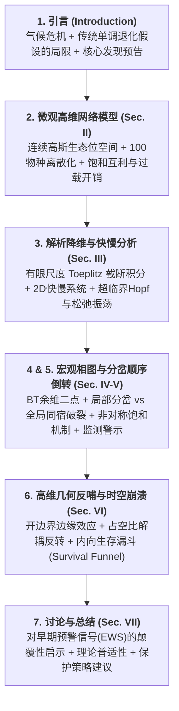

> **日期**：2026-10-22  
> **主题**：论文《*Dimensionality Reduction, Relaxation Oscillations, and Phase-Transition Order Reversal in Mutualistic Networks with Gaussian Niche Overlap*》的行文逻辑、关键无量纲参数 $\sigma/d$ 生态学内涵与 Hopf 分岔动力学推导全景解析。

---

## 一、 论文整体行文思路与架构递进

整篇论文遵循典型现代非线性物理与理论生态学顶刊（如 AIP *Chaos*、*PRE*）的**“微观建模 $\to$ 均场降维 $\to$ 相图拓扑与机制 $\to$ 反哺高维时空几何”**四步闭环逻辑：

### 1. 各章节具体行文脉络

1. **引言（Section I）**：
   - 传统生态学假定系统退化遵循“单调路径”：环境变差 $\to$ 波动加剧（临界减速） $\to$ 突变灭绝。
   - 本文抛出反直觉颠覆性论点：**退化路径不同，分岔顺序发生逆转！** 在生态位收缩下，系统会出现**“振荡平息、生物量反弹”的虚假康复表象（Deceptive Calm）**，随后突发骤死式崩溃。
2. **高维微观模型（Section II）**：
   - 在连续性状轴建立高斯生态位重叠核 $K(z_i, z_j) = \exp(-(z_i-z_j)^2/(2\sigma^2))$。
   - 考虑植物（快变量）与传粉者（慢变量，乘微小因子 $\varepsilon \ll 1$）的双分网络，并引入关键的**非线性过载开销（Over-exploitation cost, $-\eta S_{12}$）**（花粉过度掠夺与破坏），这是系统激发非线性极限环的物理动力源。
3. **解析降维与快慢系统（Section III）**：
   - 摒弃以往热力学极限（$N \to \infty$）忽略边界的弊端，采用有限尺度 Toeplitz 行和公式，严格导出宏观有效耦合强度 $(\beta_{11}, \beta_{12}, \beta_{21})$。
   - 建立 2D 快慢流形，计算平衡点、雅可比矩阵迹变号（Hopf）、以及**第一 Lyapunov 系数 $l_1 < 0$（严格证明极限环为轨道稳定超临界）**。
4. **分岔全景与相变顺序反转（Section IV & V）**：
   - **路径 A（气候恶化 $r_u \downarrow$）**：良性共存 $\to$ 超临界 Hopf（振荡预警） $\to$ 同宿分岔（Homoclinic Crisis）崩溃绝灭。
   - **路径 B（生态位收缩 $\sigma/d \downarrow$）**：超泛化振荡 $\to$ 适度重叠稳定共存 $\to$ 鞍结折叠（Saddle-Node）突发无预警绝灭。
   - 识别出余维二 **Bogdanov–Takens (BT) 奇点**；利用全微分不等式 $\left|\frac{d\,\text{Mut}}{da}\right| \ll \frac{d\,\text{Cost}}{da}$ 解析证明生态位收缩导致净收益上升（$\frac{d\Phi}{da} < 0$）的反常回升机制。
5. **高维几何与时空崩溃（Section VI）**：
   - **占空比效应（Duty Cycle Effect）**：核心种振荡峰值虽高，但因暴跌后在底部慢流形深陷休眠（约占周期 85%），导致其**时间平均生物量反而低于边缘种**。
   - **生存漏斗（Survival Funnel）**：开边界单侧互利缺失导致边缘物种最先崩溃，形成自外向内的渐进阈值收缩。
6. **总结与讨论（Section VII）**：
   - 指出经典临界减速与早期预警指标（EWS）具有强烈的路径依赖性，为生态修复与预警提供新物理依据。

---

## 二、 核心参数 $\sigma/d$ 的生态学本质：有效泛化度与相对重叠

### 1. 单独参数的生态学含义
- **$\sigma$（Niche Breadth，生态位宽度）**：物种的生理/行为泛化程度。$\sigma$ 极小代表高度特化种（Specialist，如只采特定花冠深度的蜜蜂）；$\sigma$ 很大代表广适泛化种（Generalist）。
- **$d$（Niche Spacing，性状间距）**：相邻物种在功能性状轴上的平均距离（若长度为 $L$ 上均匀分布 $N$ 个物种，则 $d \approx L/N$）。热带雨林中物种密集（$d$ 极小）；高寒稀疏群落中 $d$ 很大。

### 2. 为什么必须使用比值 $a = \sigma/d$？
相互作用的高斯核完全由无量纲比值决定：
$$K_{ij} = \exp\left( -\frac{(z_i - z_j)^2}{2\sigma^2} \right) = \exp\left( -\frac{(|i - j|\cdot d)^2}{2\sigma^2} \right) = \exp\left( -\frac{(i - j)^2}{2(\sigma/d)^2} \right)$$
自然界不在乎性状轴的绝对物理刻度，只在乎：**“单个物种的泛化跨度 $\sigma$，能够覆盖相邻几个伙伴物种的间距 $d$”**。
- **$\sigma/d$ 就是整个生态网络的“有效泛化程度（Effective Generalization Level）”或“结构连通密度”**。
- **这个值越高，物种交互范围越宽、跨界互利与相互重叠越强，网络越紧密交织。**

### 3. 当 $\sigma$ 和 $d$ 变化方向相反时的理论解析力
- **生境破碎化/物种灭绝**：中间过渡物种灭亡导致间距增大（$d \uparrow$），即使单个物种生理宽度 $\sigma$ 不变，$\sigma/d \downarrow$（网络碎片化）。
- **气候异常导致物候受限**：物种利用资源的窗口收缩（$\sigma \downarrow$），$d$ 不变，同样导致 $\sigma/d \downarrow$。
- **物种性状趋同（$d \downarrow$）而个体承受力下降（$\sigma \downarrow$）**：单独看 $\sigma$ 或 $d$ 会得出完全相反结论，唯有通过无量纲比值 $\sigma/d$ 才能精确判断系统整体是趋向过度稠密还是孤立解耦。

---

## 三、 动力学方程与 Hopf 分岔发现全流程

### 1. 二维宏观快慢动力学方程

$$\begin{aligned}
\frac{du}{dt} &= u \left[ r_u + \frac{\beta_{11}u + \beta_{12}v}{1 + q(\beta_{11}u + \beta_{12}v)} - \eta \beta_{12}v - u - c_u u^2 \right] \equiv f(u, v) \\
\frac{dv}{dt} &= \varepsilon v \left[ r_v + \frac{\beta_{21}u}{1 + q\beta_{21}u} - b_{22}v \right] \equiv \varepsilon \, g(u, v)
\end{aligned}$$
- $u$：植物宏观平均生物量（快变量）；
- $v$：传粉者宏观平均生物量（慢变量，含微小时间尺度因子 $\varepsilon = 0.05 \ll 1$）。

### 2. 发现与严格证明 Hopf 分岔的“四步法”

#### 第一步：求解正共存平衡点 $(u^*, v^*)$
由慢变量方程零斜线 $g(u, v) = 0$ 解出：
$$v^*(u) = \frac{1}{b_{22}}\left( r_v + \frac{\beta_{21}u}{1 + q\beta_{21}u} \right)$$
代入快变量方程 $f(u, v)/u = 0$，得到单变量标量平衡态方程：
$$H(u) = r_u + \text{互利}(u) - \text{开销}(u) - u - c_u u^2 = 0$$
在基准参数下解得正平衡点 $(u^*, v^*) \approx (0.1914, 0.3756)$。

#### 第二步：线性化与雅可比矩阵（Jacobian）
在平衡点附近进行微扰展开，雅可比矩阵为：
$$J = \begin{pmatrix} J_{11} & J_{12} \\ J_{21} & J_{22} \end{pmatrix} = \begin{pmatrix} \frac{\partial f}{\partial u} & \frac{\partial f}{\partial v} \\ \varepsilon \frac{\partial g}{\partial u} & \varepsilon \frac{\partial g}{\partial v} \end{pmatrix}_{(u^*, v^*)}$$
特征方程为：
$$\lambda^2 - \mathrm{tr}(J)\lambda + \det(J) = 0 \implies \lambda_{1,2} = \frac{\mathrm{tr}(J) \pm \sqrt{[\mathrm{tr}(J)]^2 - 4\det(J)}}{2}$$
当 $4\det(J) > [\mathrm{tr}(J)]^2$ 时，特征值为共轭复数：
$$\lambda_{1,2} = \mu \pm i\omega, \quad \text{其中实部 } \mu = \frac{\mathrm{tr}(J)}{2}$$
- 虚部 $\omega$：固有振荡频率；
- **实部 $\mu = \frac{\mathrm{tr}(J)}{2}$：控制系统振幅是衰减（正阻尼）还是爆发（负阻尼）的阻尼因子。**

#### 第三步：迹变号（$\mathrm{tr}(J) = 0$）精准锁定 Hopf 点
迹由两部分组成：
$$\mathrm{tr}(J) = J_{11} + J_{22} = u^* \left[ \frac{\beta_{11}}{(1 + qS)^2} - 1 - 2c_u u^* \right] - \varepsilon b_{22} v^*$$
- 慢变量项 $J_{22} = -\varepsilon b_{22} v^* < 0$：微弱但持久的耗散稳定力；
- 植物项 $J_{11}$：包含陡峭互利斜率（正反馈激励）与拥挤自抑制 $-2c_u u^*$（负反馈耗散）。

**Hopf 分岔机制**：
当气候恶化（$r_u \downarrow$）时，平衡点生物量 $u^*$ 适度下降，导致：
1. 高阶拥挤抑制 $-2c_u u^*$ 减弱；
2. 互利饱和分母 $(1+qS)^2$ 减小，互利斜率变陡（正反馈急剧增强）；
3. **在临界点 $r_u = r_{\mathrm{Hopf}} \approx -0.2105$ 处**，植物的正反馈恰好抵消了慢变量的负耗散：
   $$\mathrm{tr}(J) = 0, \quad \det(J) > 0, \quad \left.\frac{d\,\mathrm{tr}(J)}{dr_u}\right|_{r_{\mathrm{Hopf}}} < 0$$
特征值成为纯虚数 $\lambda = \pm i\omega_0$。一旦 $r_u < -0.2105$，$\mathrm{tr}(J) > 0$，平衡点由稳定焦点退化为**不稳定焦点（排斥子）**。

#### 第四步：第一 Lyapunov 系数 $l_1 < 0$ 确立“超临界”稳定极限环
平衡点失稳后，系统究竟会无限发散灭绝（亚临界），还是收敛到一个稳定的周期圈上（超临界）？
通过正规形理论计算第一 Lyapunov 系数 $l_1$：
$$l_1 = \frac{1}{2\omega_0} \mathrm{Re}\Big( \langle p, C(q, q, \bar q) \rangle - 2 \langle p, B(q, J^{-1} B(q, \bar q)) \rangle + \langle p, B(\bar q, (2 i \omega_0 I - J)^{-1} B(q, q)) \rangle \Big)$$
- $l_1 > 0$：亚临界（火上浇油式发散）；
- **$l_1 < 0$：超临界（高阶非线性项提供制动闭合圈）**。
数值与解析严格验证 $l_1 < 0$，证明**失稳后必定脱落出一个轨道渐近稳定的松弛极限环**！

---

## 四、 后续灭绝相变：同宿分岔、鞍结与 BT 奇点

| 分岔类型 | 发生条件 | 几何物理图像 | 论文中的具体对应 |
| :--- | :--- | :--- | :--- |
| **超临界 Hopf 分岔** | $\mathrm{tr}(J)=0, \det(J)>0, l_1<0$ | 正阻尼变负阻尼，静态共存失稳，孕育出稳定极限环 | $r_{\mathrm{Hopf}} \approx -0.2105$：气候恶化激发生态系统周期震荡 |
| **同宿分岔边界危机 (Homoclinic Crisis)** | 极限环与下鞍点稳定流形碰撞 | 极限环振幅扩张碰撞到鞍点分界线，闭合轨道瞬间被撕碎 | $r_{\mathrm{hom}} \approx -0.2178$：振荡骤然终止，全网直接跌入原点毁灭（**真实的动态绝灭线**） |
| **鞍结分岔 (Fold / Saddle-Node)** | $\det(J)=0$ | 两个平衡点（不稳定焦点与鞍点）相撞湮灭 | $r_{\mathrm{SN}} \approx -0.2911$：局部静态平衡点彻底消失 |
| **Bogdanov–Takens (BT) 点** | $\mathrm{tr}(J)=0, \det(J)=0$ （特征值双零 $\lambda_1=\lambda_2=0$） | 余维二分岔奇点，Hopf 线、鞍结线与同宿线的共同发源地 | $(\sigma/d)_{\mathrm{BT}} \approx 0.972, r_{u,\mathrm{BT}} \approx -0.136$：相图核心组织中心 |

---
*注：本笔记汇总自与 AI 助手 Antigravity 针对论文模型降维、动力学一致性与审稿答辩策略的深度研讨。*
